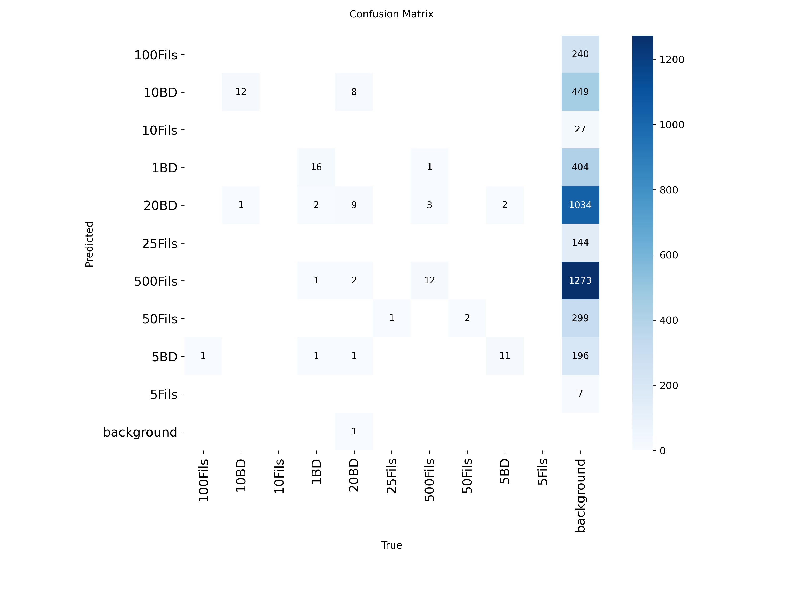

Simple Bahraini Currency Object Detection using YOLO

The model is trained on the different denominations of Bahraini Currency, when an image is uploaded, it will attempt to detect
currency.

The model really struggles with coins, as there weren't many examples in the dataset. It also almost always classifies objects as part of the background.
